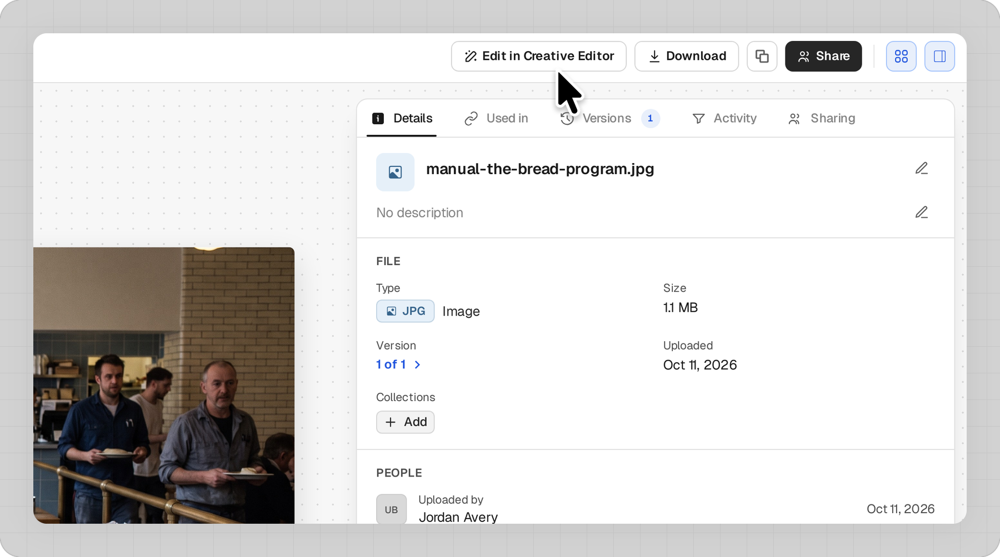
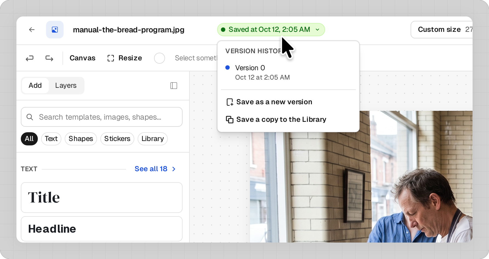
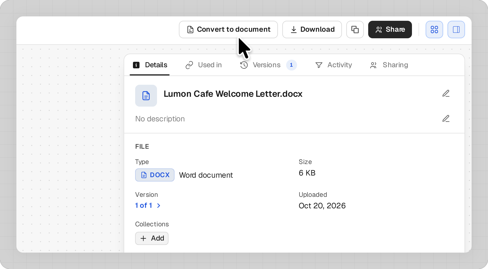
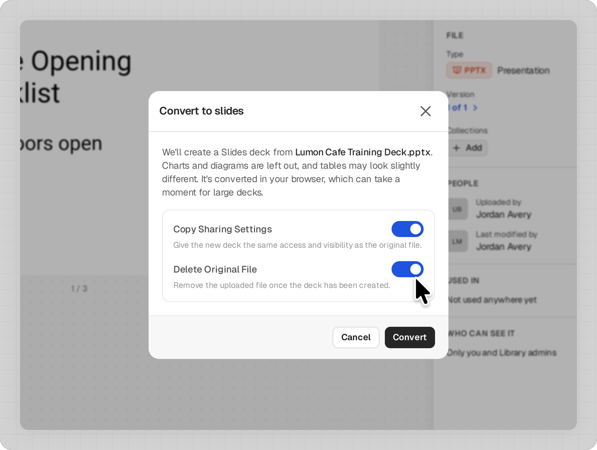
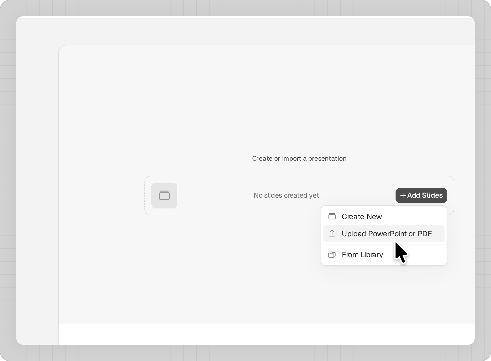

The Creative Editor lets you edit PDFs, images, and slide decks from your Library in Franchise Systems Ai (FS Ai). To start a design from scratch, see *[How to Create and Export a Design]*.

> **Prerequisite:** The Creative Editor must be enabled for your account. You also need edit access to the file.

### Edit a PDF or image

1. Open the file in **Library** (select **Assets** if Library is a folder) and click **Edit in Creative Editor**. On narrow screens, find it under **More actions**.
2. Make your changes.
3. Click **Save**.

Save adds a new version to the same file.

To keep the original as it is, click the **Saved at** status next to the file name to open **Version history**:

- **Save a copy to the Library**: saves your changes as a separate file.
- **Save as a new version**: starts another version.

### Edit a Word document

Word files open in the Document Editor, not the Creative Editor.

1. Open the .docx file and click **Convert to document**.
2. Click **Convert**.
3. On the new document, click **Open in editor**.

### Edit a PowerPoint, including Canva designs

For a Canva design, export it from Canva as a PowerPoint (.pptx) and upload it to your Library.

1. Open the .pptx file and click **Convert to slides**.
2. Both options are on by default:
   - **Copy Sharing Settings**: gives the deck the same access as the original.
   - **Delete Original File**: removes the .pptx after converting. Turn it off to keep it.
3. Click **Convert**.

The deck is saved to your Library. Open it and click **Edit in Creative Editor**.

> **Tip:** Charts and diagrams don't carry over, and tables may look slightly different. Check the deck after converting.

### Use your deck elsewhere

- **Courses**: Go to **Operations → Courses** and click **Edit Course**. Select a chapter, click **Add Lesson**, and choose **Slides**. Click **Add Slides**, then choose **Upload PowerPoint or PDF** or **From Library**. Library PowerPoints and PDFs convert automatically.
- **Projects**: In a **View slides** task, choose **Upload PowerPoint**, **Create new slides**, or **Select from Library** (converted decks only).
- **Applicant Portal**: Go to **Studio → Applicant Portal** and click **Customize** on the Applicant Portal card. Click **Add Step** and choose **Slides (FSAI Studio)**. Click **Add Slides**, then choose **Upload PowerPoint**, **Create New**, or **Choose from Library** (converted decks only) and **Select Slides**.
- **Funnel**: Funnels take PDFs, not decks. In the editor, click **Export**, set **File type** to **PDF** and **Send to** to **Save to the Library**, and click **Save to the Library**. Go to **Studio → Funnel**, open **Resources**, choose **From Library**, select the PDF, and click **Save**.

### Export a file

**Export** in the editor downloads or saves a PNG, JPEG, PDF, or PowerPoint file. See *[How to Create and Export a Design]*.
